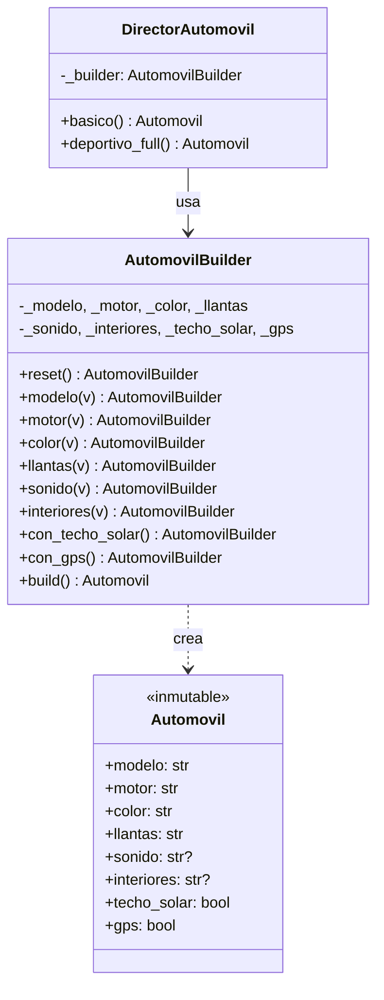
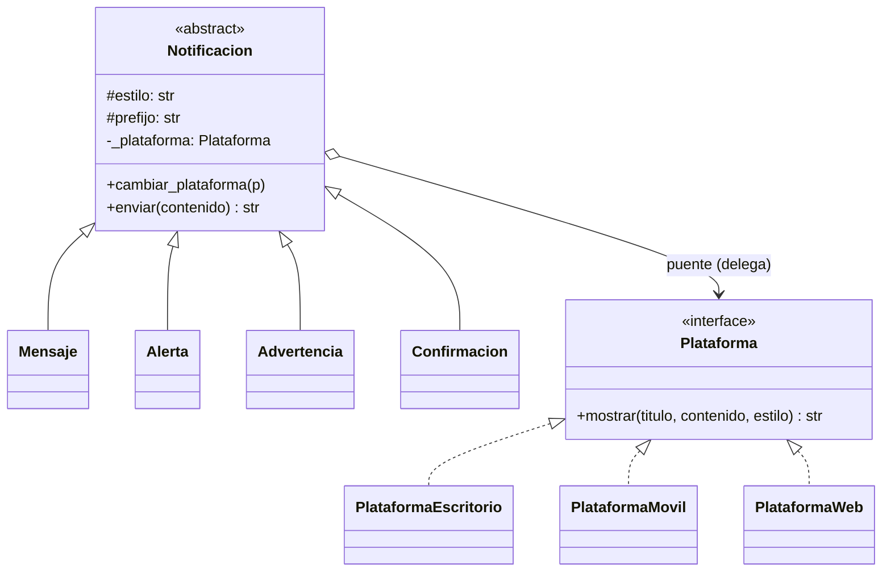
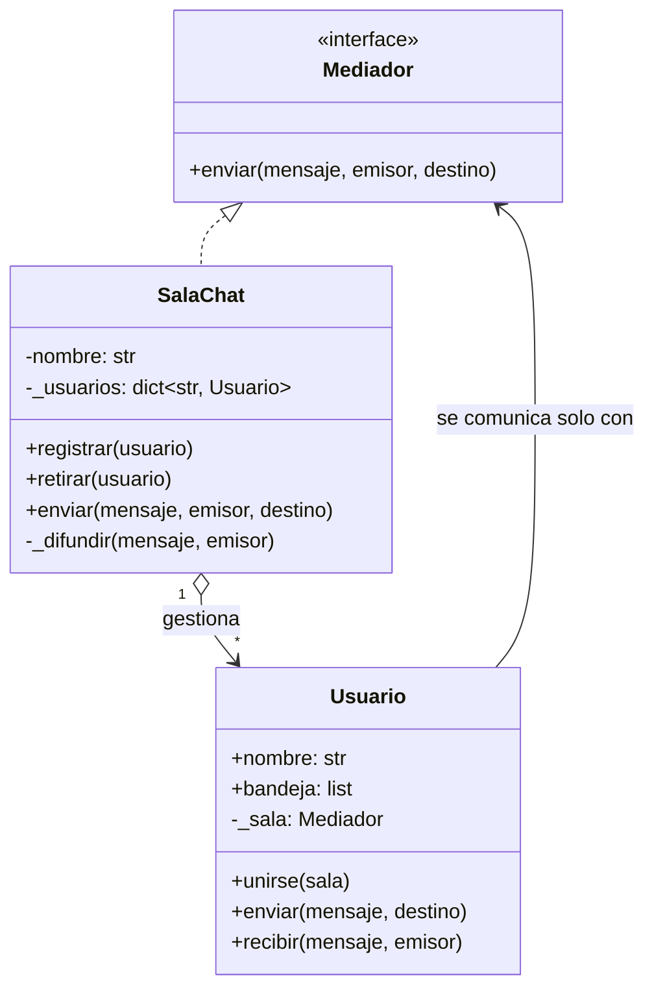

# Actividad 1 — Patrones de diseño (Python)

| # | Escenario | Tipo | Patrón |
|---|-----------|------|--------|
| 1 | Personalización de automóvil | Creacional | **Builder** |
| 2 | Notificaciones multiplataforma | Estructural | **Bridge** |
| 3 | Chat grupal | Comportamiento | **Mediator** |

Ejecución (Python 3.10+, sin dependencias):

```
python -m unittest discover -s tests      # pruebas
cd ej1_builder && python main.py          # idem ej2_bridge, ej3_mediator
```

Los diagramas están en Mermaid (se renderizan en GitHub, VS Code con la extensión Markdown Preview Mermaid o mermaid.live).

---

## 1. Builder — creacional

**Por qué es creacional:** el problema es *cómo se crea* un objeto con muchos parámetros opcionales (constructor telescópico).
**Por qué Builder:** construye el objeto paso a paso, solo con lo que el cliente pide, y separa el proceso de construcción de la representación final. Factory Method / Abstract Factory elegirían *qué clase* instanciar, pero aquí hay una única clase con muchas configuraciones; Prototype clonaría un objeto existente, que no es el problema.

| Beneficio pedido | Cómo se cumple (`ej1_builder/automovil.py`) |
|---|---|
| Legibilidad | API fluida: `.motor(...).color(...).con_gps().build()` |
| Inmutabilidad | `Automovil` es `@dataclass(frozen=True)` |
| Flexibilidad | Los opcionales se omiten; un único constructor |
| Separación construcción/representación | `AutomovilBuilder` construye; `Automovil` solo representa. `DirectorAutomovil` guarda recetas reutilizables |



---

## 2. Bridge — estructural

**Por qué es estructural:** organiza la relación entre clases para evitar la explosión de subclases (`NotificacionAlertaWeb`, `NotificacionMensajeMovil`…).
**Por qué Bridge:** hay dos dimensiones que varían de forma independiente (tipo de notificación × plataforma). Bridge las separa en dos jerarquías y la abstracción *delega* en la implementación por composición. Adapter solo reconciliaría interfaces incompatibles y Decorator añadiría comportamiento, ninguno resuelve la combinatoria.

| Beneficio pedido | Cómo se cumple (`ej2_bridge/notificaciones.py`) |
|---|---|
| Separación de responsabilidades | `Notificacion` define el *qué*; `Plataforma` define el *dónde/cómo* |
| Escalabilidad | Nueva plataforma = 1 clase; nuevo tipo = 1 clase; sin tocar el resto |
| Reducción de clases | 4 tipos + 3 plataformas = 7 clases en vez de 12 (y creciendo N×M) |
| Cambio en tiempo de ejecución | `cambiar_plataforma()` |



---

## 3. Mediator — comportamiento

**Por qué es de comportamiento:** define cómo interactúan y se comunican los objetos en tiempo de ejecución.
**Por qué Mediator:** sin él cada usuario referenciaría a todos los demás (red N×N). Con la sala como mediador cada usuario solo conoce a la sala (N conexiones). Observer notificaría a suscriptores de un sujeto, pero aquí se necesita lógica de enrutamiento (difusión y privados) centralizada.

| Beneficio pedido | Cómo se cumple (`ej3_mediator/chat.py`) |
|---|---|
| Mantenimiento | Agregar/retirar usuarios solo toca `SalaChat.registrar/retirar` |
| Mejor organización | Enrutamiento, validaciones y difusión viven en `SalaChat` |
| Menor complejidad | `Usuario` no guarda referencias a otros usuarios |



---

## Estructura

```
patrones-diseno-python/
├── README.md
├── ej1_builder/    automovil.py, main.py
├── ej2_bridge/     notificaciones.py, main.py
├── ej3_mediator/   chat.py, main.py
└── tests/          test_patrones.py
```
